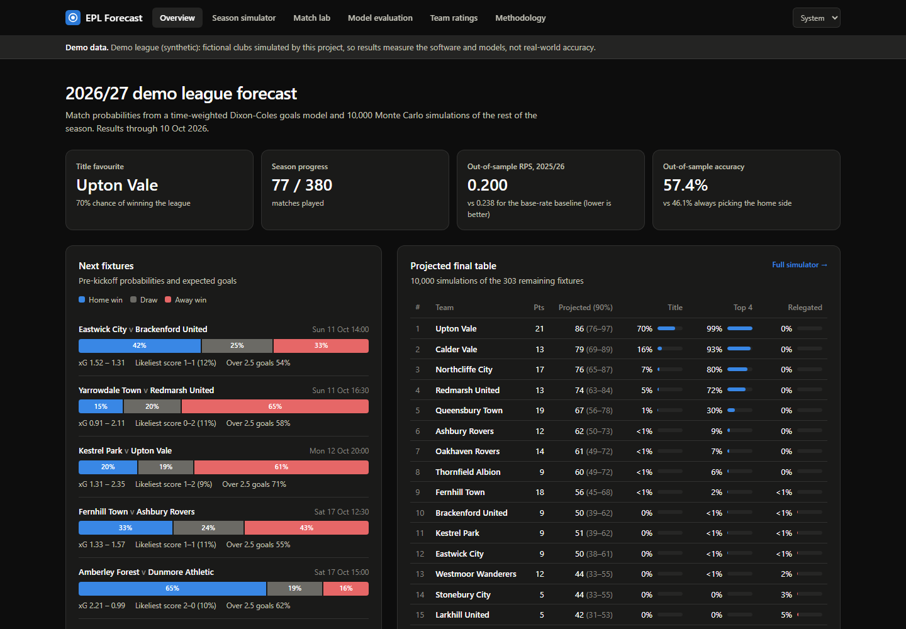

# EPL Forecast

**A full-stack forecasting system for football leagues.** It is built around:
- a validated, idempotent data pipeline;
- leakage-proof statistical models, evaluated walk-forward;
- a typed FastAPI service with bounded expensive work, cross-process cache consistency and persisted jobs;
- a tested React/TypeScript dashboard.

It runs out of the box on a **synthetic demo league** (fictional clubs), so anyone can clone, build, test and
serve it offline without restricted data. Real Premier League data can be used locally, but it is never
redistributed: see [Data and licensing](#data-and-licensing).



## What you can verify in ten minutes
| Claim | Evidence | Command |
| --- | --- | --- |
| A fresh clone builds and runs offline | `tests/test_datasets.py::test_demo_build_needs_no_network`; CI runs it on a fresh checkout | `uv sync --all-extras && uv run epl build --skip-backtest && uv run epl serve` |
| Forecasts never see the future | Leakage tests and a test double in the walk-forward harness | `uv run pytest tests/test_features.py tests/test_evaluation.py` |
| Expensive endpoints are bounded | 422 / 429 / 503 / storage-cap tests, plus a pool-starvation regression test | `uv run pytest tests/test_security.py` |
| A refresh is visible to a running API without a restart | Cross-process freshness and persisted-job tests | `uv run pytest tests/test_reliability.py` |
| The dashboard's main flows work | 12 user-flow tests (loading, errors, paging, keyboard toggles, routing) | `cd frontend && npm test` |
| The track record only shows forecasts made before kickoff | Selection, paging and scoring tests, a migration test and a PostgreSQL time-zone test | `uv run pytest tests/test_track_record.py` |
| Performance figures are reproducible | JSON artifact with workload, hardware and results | `uv run python scripts/benchmark.py` |
| No restricted data ships | Git file list and the real Docker build context are checked | `uv run python scripts/check_distribution.py --docker` |

A guided tour is in [`docs/DEMO.md`](docs/DEMO.md). Users, acceptance criteria and exclusions are in
[`docs/SCOPE.md`](docs/SCOPE.md).

## Architecture
```mermaid
flowchart LR
    SRC[Sources: demo (synthetic) / openfootball (public domain) / Premier League (local only)] -->|epl extract| RAW[data/&lt;dataset&gt;/ snapshots]
    RAW -->|epl load: validate + upsert + data version, one transaction| DB[(SQLite or PostgreSQL)]
    DB --> F[Point-in-time features] --> M[Forecasters]
    M -->|epl backtest| R[Walk-forward report]
    M -->|epl train| REG[Model registry]
    DB --> API[FastAPI]
    REG --> API
    API <--> C[(Bounded simulation cache)]
    API <--> J[(Jobs with leases)]
    API --> UI[React dashboard]
```
- **Layers:** routers only translate HTTP; services hold the use-cases; the repository is the only code that
  queries match data. See [`docs/ARCHITECTURE.md`](docs/ARCHITECTURE.md) for the consistency model and the
  failure-mode table.
- **Decisions:** seven ADRs cover data licensing, point-in-time features, bounded work, cache invalidation, jobs,
  the production model and the deployment shape. Each records the alternatives that lost
  ([`docs/adr/`](docs/adr/README.md)).

## Interfaces
**REST API** (`/api/v1`). Responses are typed Pydantic models; errors are RFC 9457 problem documents. The contract
is committed as [`docs/openapi.json`](docs/openapi.json), and the dashboard's TypeScript types are generated from
it. The CI workflow is set up to fail if either drifts from the code.

| Endpoint | Notes |
| --- | --- |
| `GET /predictions/upcoming`, `GET /predictions/matchup?home=&away=` | Result probabilities, expected goals, scoreline grid, markets |
| `GET /seasons/{season}/simulation?as_of_matchweek=&runs=` | Monte Carlo; `runs` ∈ {1,000, 10,000}; cached; rate-limited per client (429) and concurrency-gated (503) |
| `GET /seasons/{season}/standings`, `/fixtures` | Table at any matchweek; fixtures and results |
| `GET /ratings`, `GET /teams/{id}/elo` | Team strengths; Elo history |
| `GET /evaluation/backtest`, `GET /models`, `GET /predictions/live` | Evaluation report, model registry, live scoring of logged forecasts |
| `GET /predictions/log?season=&status=&limit=&offset=` | Track record: each match's latest forecast logged before kickoff, with its RPS once played; paged in SQL |
| `GET /health`, `GET /ready`, `GET /meta` | Liveness; readiness (database and model); dataset, data version and model version |
| `POST /admin/refresh`, `GET /admin/jobs/{id}` | Disabled unless a strong `EPL_ADMIN_TOKEN` is set; one active refresh across all processes |

**CLI** (`uv run epl --help`): `extract`, `load`, `tune`, `backtest`, `train [--if-missing]`, `predict`, `simulate`,
`refresh`, `build`, `serve`, `openapi`, `db upgrade|check`.

## Data and licensing
| Dataset (`EPL_DATASET`) | What | License / terms | In Git and the image? |
| --- | --- | --- | --- |
| `demo` (default) | Four seasons of a fictional 20-club league, generated with drifting team strengths, promotion and relegation | Generated by this project (MIT) | Yes |
| `openfootball` | Real Premier League fixtures and scores (no match statistics) | Public-domain dedication: "Use as you please with no restrictions whatsoever." | Yes (snapshots and evaluation report) |
| `premier-league` | The Premier League website's API, including match statistics | The site's terms prohibit reproducing or redistributing its material and building a database from it | **No.** Local, personal use only |

All paths are scoped by dataset (`data/<dataset>/`, `data/<dataset>.db`, `data/artifacts/<dataset>/`). Allow-lists
in `.gitignore` and `.dockerignore` admit only redistributable datasets. `scripts/check_distribution.py` verifies
the Git file list and the real Docker build context, and every image build fails if a restricted directory is
present ([ADR 0001](docs/adr/0001-dataset-scoping-and-demo-league.md)).

**Consistency:** each load validates first, then upserts and records a data version in one transaction, and an
unchanged reload is a no-op. Model publication swaps a pointer file atomically, and API processes notice new data
or models within about a second ([ADR 0004](docs/adr/0004-cache-invalidation-by-data-version.md)).

## Security and failure handling
- **Bounded work.** `runs` is restricted to the allowed sizes. Concurrent identical requests share one
  computation. Each client may start 20 new simulations a minute, at most 2 run at once, and a queued request
  that can't start within 10 s gets 503 with `Retry-After`. The cache is trimmed to 256 rows. One 50,000-run
  request used to cost 1.7 s and 171 MiB with no bound
  ([ADR 0003](docs/adr/0003-bounded-simulation-work.md)).
- **Secrets.** The admin token is a `SecretStr`. The app refuses to start with a token shorter than 32 characters
  or a known placeholder. It is compared in constant time and never logged (tested). Compose provides no default.
- **Jobs.** Refresh jobs are stored with a lease. A job whose process died is marked failed rather than left
  "running"; a second refresh gets 409 ([ADR 0005](docs/adr/0005-persisted-jobs-with-leases.md)).
- **Containers.** Multi-stage image, non-root user, healthcheck, demo data and models baked in. The bundled
  PostgreSQL in docker-compose publishes no port.
- **Limits of this model.** Rate limits and coalescing are per process (the documented operating model is one
  process). Reads are unauthenticated by design. Model artifacts are pickles and are only loaded from this
  project's own registry.

## Testing
| Suite | What it covers |
| --- | --- |
| Backend (`uv run pytest`) | Features and leakage, model correctness (gradient check, parameter recovery on synthetic leagues, registry round-trips), metrics, walk-forward harness, data validation and idempotency, the API contract, adversarial inputs and limits, concurrency, cross-process freshness, job restarts and leases, distribution rules, and documentation references |
| Backend on PostgreSQL (`pytest -m postgres`) | Loads, data versions, partial-index job exclusivity, the UTC-kickoff migration, and track-record selection under three session time zones, against a real PostgreSQL 17 |
| Frontend (`cd frontend && npm test`) | Formatting and chart helpers, plus user flows on the real routes against a fake API whose fixtures are typed by the generated OpenAPI schema |

Static checks: ruff (lint and format) and mypy over `src/` and `scripts/`; TypeScript `strict` with
`noUncheckedIndexedAccess`; Prettier. The CI workflow ([`.github/workflows/ci.yml`](.github/workflows/ci.yml))
runs all of these, plus the distribution check, migration drift, the PostgreSQL job and a Docker smoke test, on
every push to `main` and every pull request.

## Performance (measured, demo data)
One `epl serve` process (single uvicorn worker), SQLite, localhost. Windows 11, CPU reported as "AMD64 Family 25 Model 80", 16 logical
CPUs, 15.4 GiB RAM. Artifact: [`docs/benchmarks/2026-10-11-demo.json`](docs/benchmarks/2026-10-11-demo.json).
Figures depend on the hardware; compare runs on the same machine only.

| Workload | Result |
| --- | --- |
| Read mix: 2,000 requests from 8 clients (forecasts, standings, ratings, Elo, matchups, a cached simulation) | 274 req/s; p50 26.6 ms, p95 50.6 ms, p99 122.5 ms; 0% errors |
| The same read mix before response memoisation | 131 req/s; p50 59.2 ms, p95 91.3 ms ([artifact](docs/benchmarks/2026-10-11-demo-before-memoisation.json)) |
| Cold 10,000-run season simulation, sequential | p50 280 ms |
| 30 concurrent *uncached* simulations from one client | 11 computed and 19 rejected with 429; max 1.3 s; no 5xx |
| Server memory (resident, including the interpreter's child process) | 218 MiB at start, 234 MiB at the end of all three workloads |

Benchmarking also found a real concurrency bug. Requests queued for a simulation slot held pooled database
connections, starving the slot holders. It is fixed, with a regression test
(`tests/test_security.py::test_waiting_requests_do_not_starve_the_connection_pool`).

## Forecasting results
The production model is a time-weighted **Dixon-Coles** goals model written from scratch: penalised maximum
likelihood with an analytic gradient and a learned promoted-team prior
([ADR 0006](docs/adr/0006-goals-model-in-production.md)). Every model is evaluated **walk-forward**: refitted
before each week of fixtures on earlier results only, then scored with the ranked probability score (RPS) and
bootstrap 95% CIs. Hyperparameters are tuned on the 2024/25 season only, so 2025/26 is an untouched holdout.

### Demo league (synthetic; reproducible from this repository)
**Holdout season** (never used for any decision):

| Model | RPS ↓ | 95% CI | Log loss ↓ | Accuracy | ECE | vs baseline | Share of achievable gain |
| --- | ---: | :---: | ---: | ---: | ---: | ---: | ---: |
| Oracle (true probabilities) | 0.1949 | 0.182–0.209 | 0.923 | 57.1% | 0.035 | p < 0.001 | — |
| Logistic regression | 0.1973 | 0.183–0.212 | 0.936 | 57.6% | 0.050 | p < 0.001 | 94% |
| Ensemble | 0.1991 | 0.185–0.213 | 0.939 | 59.2% | 0.035 | p < 0.001 | 90% |
| **Dixon-Coles (production)** | 0.2002 | 0.186–0.215 | 0.944 | 57.4% | 0.033 | p < 0.001 | 88% |
| Gradient boosting | 0.2008 | 0.188–0.214 | 0.951 | 57.9% | 0.034 | p < 0.001 | 86% |
| Elo → ordered logit | 0.2063 | 0.191–0.221 | 0.960 | 56.6% | 0.049 | p < 0.001 | 73% |
| Baseline (base rates) | 0.2378 | 0.232–0.244 | 1.045 | 46.1% | 0.011 | — | 0% |

380 matches, season 2025/26; generated 2026-10-11T04:15:55+00:00 from `demo` data.

**Tuning season** (hyperparameters were chosen here; this is why Dixon-Coles is the production model):

| Model | RPS ↓ | 95% CI | Log loss ↓ | Accuracy | ECE | vs baseline | Share of achievable gain |
| --- | ---: | :---: | ---: | ---: | ---: | ---: | ---: |
| Oracle (true probabilities) | 0.1847 | 0.169–0.200 | 0.907 | 59.2% | 0.024 | p < 0.001 | — |
| **Dixon-Coles (production)** | 0.1870 | 0.172–0.202 | 0.911 | 58.4% | 0.033 | p < 0.001 | 96% |
| Ensemble | 0.1901 | 0.175–0.205 | 0.925 | 58.9% | 0.032 | p < 0.001 | 90% |
| Elo → ordered logit | 0.1943 | 0.179–0.210 | 0.938 | 57.6% | 0.040 | p < 0.001 | 82% |
| Logistic regression | 0.1961 | 0.181–0.211 | 0.950 | 56.6% | 0.049 | p < 0.001 | 78% |
| Gradient boosting | 0.2014 | 0.188–0.215 | 0.963 | 56.8% | 0.038 | p < 0.001 | 68% |
| Baseline (base rates) | 0.2378 | 0.233–0.243 | 1.058 | 43.9% | 0.017 | — | 0% |

380 matches, season 2024/25; generated 2026-10-11T04:15:55+00:00 from `demo` data.

What these numbers support, and what they don't:
- Every model beats the base-rate baseline decisively (p < 0.001), and the production model captures 88–96% of
  the improvement that was achievable at all (baseline → oracle).
- On the holdout, logistic regression is ahead of Dixon-Coles by 0.003 RPS. A paired test says that is noise
  (p = 0.44); the production choice was made on the tuning season and on the need for scorelines.
- Several tuned optima sit on the edges of their grids (for Dixon-Coles: almost no time decay and weak shrinkage).
  That fits the generator, whose club strengths are persistent and widely spread; the tuner records these edges in
  `data/artifacts/demo/hyperparameters.json`.
- Tables are generated from the committed report by `scripts/report_table.py`.

Because the league is synthetic, the report includes an **oracle**: the score of a forecaster that knew the true
generating probabilities. These numbers measure the pipeline and models on realistic but artificial data, not
real-world forecasting skill. The generator was calibrated against three aggregate Premier League statistics
(points spread, home-win rate and goals per match) so that its difficulty is realistic; it produces somewhat
fewer draws than real football.

### Real Premier League results (openfootball, public domain)
Real fixtures and scores from [openfootball/football.json](https://github.com/openfootball/football.json), which
dedicates its data to the public domain. The data holds results only (no shots or possession), so the models use
only features derived from results. The protocol is the same as for the demo: hyperparameters were tuned on
2024/25 only (`data/artifacts/openfootball/hyperparameters.json`), and 2025/26 was untouched until the final run.

**Holdout season** (never used for any decision):

| Model | RPS ↓ | 95% CI | Log loss ↓ | Accuracy | ECE | vs baseline |
| --- | ---: | :---: | ---: | ---: | ---: | ---: |
| **Dixon-Coles (production)** | 0.2130 | 0.202–0.224 | 1.039 | 47.6% | 0.038 | p = 0.006 |
| Gradient boosting | 0.2137 | 0.202–0.226 | 1.048 | 50.5% | 0.039 | p = 0.011 |
| Ensemble | 0.2159 | 0.204–0.229 | 1.049 | 48.2% | 0.040 | p = 0.038 |
| Logistic regression | 0.2181 | 0.206–0.232 | 1.055 | 49.7% | 0.051 | p = 0.110 |
| Elo → ordered logit | 0.2206 | 0.208–0.235 | 1.065 | 47.1% | 0.056 | p = 0.240 |
| Baseline (base rates) | 0.2280 | 0.222–0.235 | 1.084 | 42.6% | 0.026 | — |

380 matches, season 2025/26; generated 2026-10-16T03:28:10+00:00 from `openfootball` data.

On the tuning season (2024/25), where the hyperparameters were chosen, Dixon-Coles scored 0.1972 against a
baseline of 0.2355, and every model beat the baseline (p < 0.001). That gap is optimistic, for the reason below.

What these numbers support, and what they don't:
- On the untouched season, the production model has the best RPS of the six and beats the base-rate baseline
  (paired test, p = 0.006; the improvement is 0.015 RPS, 95% CI 0.005–0.026).
- It is statistically tied with gradient boosting (a difference of 0.0008 RPS, p = 0.83). Logistic regression
  and the Elo model do not beat the baseline significantly on this season.
- The gain over the baseline shrank from 0.038 RPS on the tuning season to 0.015 on the holdout. 2025/26 had more
  draws (27.4% against 24.5%), and the production model never makes a draw its single most likely outcome (the
  others do so in at most 5 of 380 matches). One holdout season cannot separate a harder season from optimism in
  the tuned settings.
- Three tuned values sit on the edge of their grids (Elo home advantage, and gradient boosting's learning rate and
  iteration count); the tuner records them in the hyperparameters file. Wider grids might help those models.
- There is no bookmaker benchmark, so nothing here says how the model compares with market odds. The source is
  community-maintained with no accuracy guarantee; it passed the same validation as every dataset.
- The current season (2026/27) had 50 results in this snapshot (up to 2026-09-20). That is too few to interpret,
  so it is in the report but not quoted here.

To reproduce (re-extracting fetches the latest files, so current-season rows will differ):
```bash
export EPL_DATASET=openfootball
uv run epl extract -s 2023 -s 2024 -s 2025 -s 2026 && uv run epl load
uv run epl tune && uv run epl backtest   # about 10 minutes
uv run python scripts/report_table.py --report data/artifacts/openfootball/backtest/report.json
```

The restricted Premier League dataset was also evaluated locally. Nothing derived from it is published.

## Quickstart
Prerequisites: Python 3.11+ with [uv](https://docs.astral.sh/uv/), and Node 22 (for the dashboard's dev server
and tests). Docker is optional.

```bash
uv sync --all-extras
uv run epl build --skip-backtest   # database + models from data/demo, in seconds (the backtest report is committed)
uv run epl serve                   # API and dashboard on http://127.0.0.1:8000 (API docs at /api/v1/docs)
```
```bash
uv run epl build                   # full rebuild including the walk-forward backtest (about 4 minutes)
cd frontend && npm ci && npm run dev   # dashboard with hot reload on :5173, proxying /api to :8000
docker compose up --build          # API + dashboard on PostgreSQL, http://localhost:8000
```
Configuration is through `EPL_*` environment variables or a `.env` file (see `.env.example`). To use real data
locally: `EPL_DATASET=openfootball uv run epl extract -s 2023 -s 2024 -s 2025 -s 2026` (public domain), or
`EPL_DATASET=premier-league` under that site's terms.

## Scope and limitations
- **No real users.** Nothing here claims adoption or production operation.
- **No bookmaker benchmark yet.** Market odds are the real bar for forecasting skill.
- **One real holdout season.** Real-data results cover a single untouched season of public-domain results; the
  demo results are synthetic (see above).
- **Static simulations.** Simulations freeze team strength at the cutoff, so early-season outcome ranges are
  slightly too narrow.
- **Single-process limits.** Rate limits are per process; multi-instance deployment would need a shared limiter
  at the proxy.

Full list: [`docs/SCOPE.md`](docs/SCOPE.md).

## How this was built
Built with AI-assisted development under the author's direction. The author chose the problem, set the
requirements (data licensing, security and resource limits, reliability, testing) and the review criteria, and
decided what to accept.

## Project structure
```
src/epl/
├── core/          settings (dataset-scoped paths, secret checks), structured logging
├── data/          datasets registry, sources (synthetic, openfootball, Premier League), validation, load, schema, repository, migrations
├── features/      point-in-time form features, Elo
├── models/        Dixon-Coles, classifiers, ensemble, model zoo, registry
├── evaluation/    scoring rules + bootstrap, walk-forward backtest, tuning
├── simulation/    vectorised Monte Carlo season simulator
├── services/      forecasting, pipeline, simulation cache, jobs
├── api/           app factory, routers, schemas, state (versioned caches), limits, middleware
└── cli.py
frontend/src/      typed API client and hooks, chart components, pages, user-flow tests
scripts/           benchmark, distribution check
tests/             backend tests and synthetic-league factories
data/demo/         committed synthetic dataset; data/artifacts/demo/ its backtest report
docs/              architecture, ADRs, scope, demo walkthrough, model card, OpenAPI, benchmarks
```

## License
Code: MIT ([LICENSE](LICENSE)). Data: see [Data and licensing](#data-and-licensing). Forecasts are probabilities,
not betting advice.
