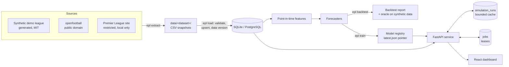
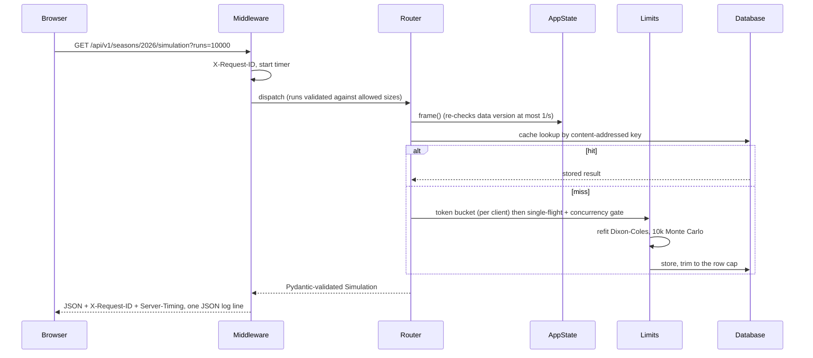

# Architecture

This document describes how the system fits together. The *why* behind each major choice, with the alternatives
that were rejected, is in the [architecture decision records](adr/README.md).

## Components

| Layer | Code | Responsibility |
| --- | --- | --- |
| Configuration | `src/epl/core/config.py` | 12-factor settings (`EPL_*`); dataset-scoped paths; secret handling and strength checks |
| Data sources | `src/epl/data/sources/` | Each source writes the same snapshot format (`epl/data/snapshots.py`) |
| Load | `src/epl/data/load.py`, `validate.py`, `db.py` | Validation, then idempotent upserts and a data version in one transaction |
| Read model | `src/epl/data/repository.py` | The only code that queries match data; returns a typed DataFrame |
| Features and models | `src/epl/features/`, `src/epl/models/` | Leakage-free features; forecasters behind one `Forecaster` interface |
| Evaluation | `src/epl/evaluation/` | Walk-forward backtest, proper scoring rules, bootstrap, tuning |
| Services | `src/epl/services/` | Use-cases shared by the CLI and API: forecasting, pipeline, simulation cache, jobs |
| API | `src/epl/api/` | Routers (HTTP translation only), schemas (the contract), state, limits, middleware |
| Dashboard | `frontend/src/` | Typed client generated from OpenAPI, TanStack Query hooks, SVG chart components |

## Consistency model
- **Loads are atomic.** Validation errors abort before any write. Upserts and the new `data_versions` row commit
  in one transaction, so a reader never sees a data version without its rows (or the reverse).
- **Loads are idempotent.** Upserts are keyed on natural keys, and an unchanged reload does not create a new data
  version (it compares a content fingerprint).
- **Model publication is atomic.** Artifacts are written first; then `latest.json` is replaced with
  `os.replace`.
- **Readers converge quickly.** API processes re-read the latest data version and model pointer at most once per
  second, and rebuild cached values that are out of date ([ADR 0004](adr/0004-cache-invalidation-by-data-version.md)).
- **Kickoffs are compared in UTC.** Sources publish naive UK local time. The loader also stores the same
  instant as `matches.kickoff_utc` (Europe/London rules, not a fixed offset) and rejects times that are
  ambiguous or nonexistent when the clocks change. Forecast timestamps are UTC, so "before kickoff" compares UTC
  with UTC on both SQLite and PostgreSQL.
- **A track-record page is one statement.** Selection (the latest forecast before kickoff per match, by window
  function), the total and the page come from one SQL statement, so `total` and `items` share a snapshot.
- **Simulation results are content-addressed.** The cache key includes a hash of the history and the
  hyperparameters, so a stale result cannot be served even before retention trims it.

## Operating model
One API process (one uvicorn worker) serves the dashboard and API, as in the Docker image. It works with SQLite
or with PostgreSQL (`docker compose`). Resource limits and the single-flight map are per process. Job
exclusivity and cache freshness work across processes, because they rely on the database.

## Failure modes
| Failure | Behaviour | Evidence |
| --- | --- | --- |
| Bad or inconsistent snapshot (duplicate ids, impossible scores, possession not summing to 100) | Load aborts and nothing is written | `tests/test_data.py::test_invalid_snapshot_is_not_loaded` |
| No snapshots for the configured dataset | Clear error naming the dataset and the fix | `tests/test_reliability.py::test_missing_snapshots_fail_clearly` |
| Upstream API slow or failing during extract | Timeout on every request; retries with backoff on 429/5xx; a failed refresh job is recorded with its error | `tests/test_pipeline.py::test_default_session_retries_transient_errors`, `tests/test_reliability.py::test_failed_work_is_recorded_with_its_error` |
| Process dies mid-refresh | The lease expires and the next process marks the job failed (interrupted) | `tests/test_reliability.py::test_a_job_whose_process_died_is_marked_failed` |
| Two workers start a refresh | The second gets 409 (partial unique index) | `tests/test_reliability.py::test_only_one_refresh_can_be_active_across_workers` |
| Data loaded by the CLI while the API runs | Served within the check interval | `tests/test_reliability.py::test_data_loaded_by_another_process_is_served` |
| Model not trained yet | `/ready` reports degraded; model endpoints return 503 problem documents | `tests/test_api.py::test_ready_is_degraded_without_a_model` |
| Flood of distinct uncached simulations | 422 for unsupported sizes, 429 per client, 503 at saturation; storage capped | `tests/test_security.py` |
| Burst of identical uncached simulations | One computation shared by all callers | `tests/test_security.py::test_concurrent_identical_requests_compute_once` |
| Unknown API path | JSON 404 problem (never the SPA's `index.html`) | `tests/test_api.py::test_dashboard_is_served_with_spa_fallback` |
| A kickoff that is ambiguous or nonexistent in UK time | Load aborts, listing every such match | `tests/test_track_record.py::test_validation_lists_every_unconvertible_kickoff` |
| A migration rebuilds a referenced SQLite table | Foreign-key enforcement is paused for the run and checked before commit, so no referencing rows are lost | `tests/test_track_record.py::test_upgrade_backfills_utc_and_keeps_every_referencing_row` |
| A forecast is logged after kickoff | Never shown or scored; the match keeps its earlier forecast | `tests/test_track_record.py::test_a_forecast_after_kickoff_never_hides_the_earlier_one` |

## Request lifecycle

